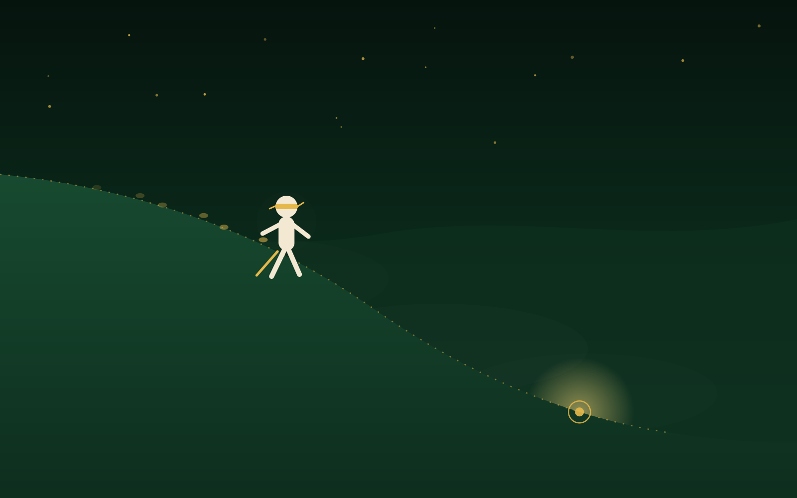
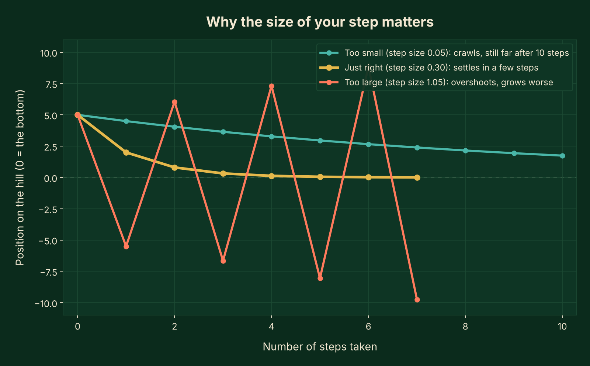
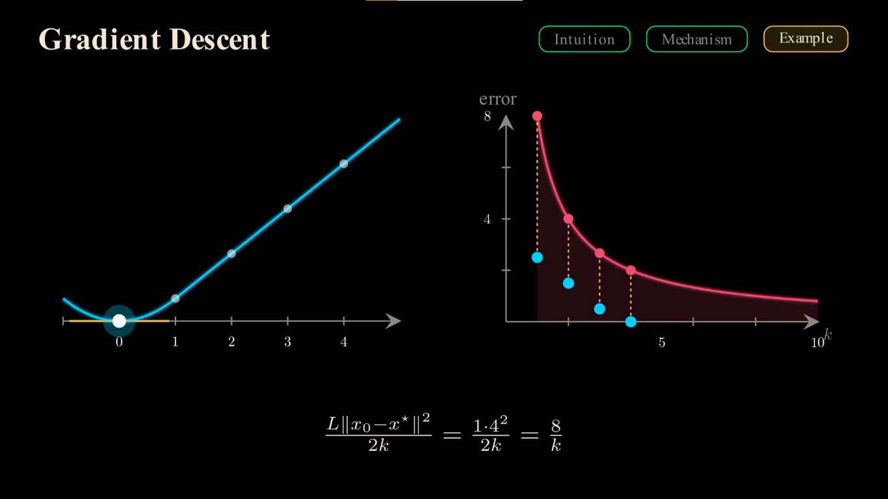
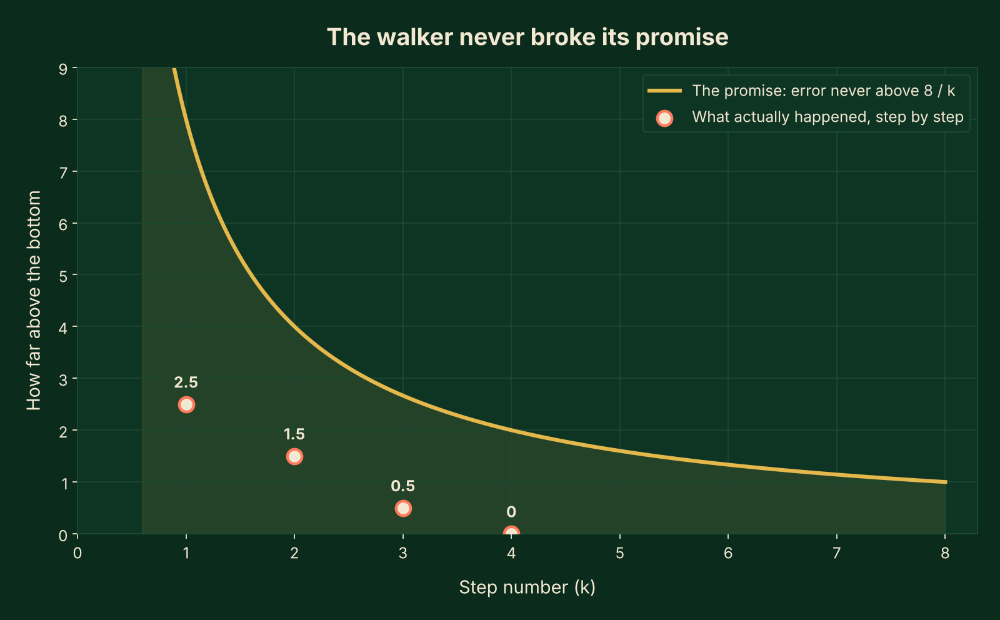

Picture this: someone blindfolds you halfway up a hillside and asks you to find the lowest point. You cannot see a thing. All you can do is feel which way the ground tilts under your shoes, take one step, and feel again.

That exact walk is what every machine learning model performs, over and over, while it is being trained. Its hillside is just built out of numbers instead of rocks and grass. By the end of this post you will know how that walk works, why the size of each step can make or break it, and why mathematicians can actually prove, not just hope, that the walk ends at the bottom.

*The same blind walk every learning model performs, just with numbers instead of rocks and grass.*

## What does it mean for a machine to "get it wrong"?

Say you are building a model to guess house prices. You feed it a house, and it spits out a number: maybe $300,000. The real price was $340,000. Your model was wrong by $40,000.

Mathematicians give that wrongness a name: a loss function, sometimes called a cost function. It is simply one number that says how bad the current guess is. Zero would mean a perfect guess. The bigger the number, the worse the guess.

Now stretch that idea out. A model's guess is controlled by many adjustable numbers inside it, called parameters (you may also hear them called weights). Change the parameters, and the guess changes. Learning means searching for the set of parameters that makes the loss as small as possible, across every house the model has ever seen.

Here is the connection to our hillside. Imagine plotting the loss on a graph, with height representing how wrong the model currently is. Tall places are bad guesses. The lowest point is the best possible guess the model can make. That shape, that imaginary hillside built entirely out of right and wrong guesses, is the hill you are blindfolded on.

So what is the "slope under your feet"? It is called the gradient: a simple measure of which direction makes the loss grow fastest, and by how much. Walking in the opposite direction, downhill, is how you make the loss smaller.

Put that together and you get the whole idea in one sentence. Gradient descent means: feel the slope, step downhill, feel again, repeat, until you cannot go down any further.

## Why the size of your step decides everything

Here is where it gets interesting. Suppose you take tiny, cautious steps down that blindfolded hill. You are completely safe. You will also be out there for a very long time, because each step barely moves you.

Now suppose you take giant, confident strides instead. You might stride right past the lowest point of the valley and land partway up the opposite wall, further from the bottom than when you started. Take another giant stride back, and you might overshoot again, bouncing from wall to wall and never settling anywhere.

Mathematicians call the size of each step the learning rate. Picking it well is one of the most important decisions in training any model.

*The exact same hill, three different step sizes, three very different endings.*

I generated the chart above from a real, computed example, starting five units from the bottom in each case. With a step size of 0.05, the walker is still almost two units away after ten whole steps: safe, but painfully slow. With a step size of 0.30, it settles close to the bottom in about five steps. With a step size of 1.05, it does not settle at all. It swings from one side of the valley to the other, and each swing is bigger than the last.

That last line is the surprising part. A step size that is too large does not just fail to help. It can leave your model in a worse spot than before it ever started learning.

## When my own students could not picture this hill, I built one

I teach advanced mathematics and statistics, and gradient descent is one of those ideas that sounds simple on a whiteboard and still leaves students stuck. No matter how carefully I wrote out the equations, some of them could not picture an actual hillside made of numbers, a walker feeling their way down it, or what a "proof" about that walk even looks like.

So I animated it. Using Manim, the same animation engine behind 3Blue1Brown's videos, I built a full visual proof of exactly how fast gradient descent is guaranteed to converge, worked through on a real example from start to finish.

*A frame from the full animated proof below.*

Watch the full explanation: Gradient Descent Convergence Explained, Why Does It Actually Converge?

<iframe src="https://www.youtube.com/embed/kzVR-1mnQOI" style="position:absolute;top:0;left:0;width:100%;height:100%;" frameborder="0" allowfullscreen></iframe>

## For those who like the math

This part is optional. If you are happy knowing "feel the slope, step downhill, repeat," skip straight to the next section.

In the video above, the walker starts exactly 4 units from the bottom of the valley. The hill has a special property mathematicians call smooth: its slope never changes more sharply than a fixed rate, called L. Here, L happens to equal 1, so the step size that is mathematically guaranteed to be safe is also 1.

$$ \text{next guess} = \text{current guess} - (\text{step size}) \times (\text{slope at current guess}) $$

Walk it out with real numbers, and the walker's position goes 4, then 3, then 2, then 1, then 0: the very bottom, reached in exactly four steps. After each step, here is how far above the bottom (how wrong the model still is) the walker stood: 2.5, then 1.5, then 0.5, then 0.

Here is the part that turns this from an observation into a guarantee. Because the hill is smooth, and shaped like a single bowl with only one lowest point (a property called convex), mathematicians can prove a hard ceiling on the mistake after any number of steps k. For this starting point, that ceiling is 8 divided by k.

$$ \text{mistake after } k \text{ steps} \;\le\; \frac{8}{k} $$

*The guarantee holds exactly as promised, in every single step of the real example above.*

Notice the shape of that ceiling. It decays like "one over k," which has a plain-language meaning worth sitting with: to make your mistake ten times smaller, you generally need about ten times more steps. Early steps buy you a lot of improvement cheaply. Later steps buy you less and less for the same effort, the same way the first few hours of practicing a new skill improve you faster than the hundredth hour does.

This is not a new invention, either. The French mathematician Augustin-Louis Cauchy described this exact walk in a short note in 1847, while trying to calculate the orbit of a star using algebra instead of solving much harder equations by hand. Almost two centuries later, a direct descendant of that same walk, called stochastic gradient descent, has become the basic method used to train most of today's deep learning models: feel the slope, take a safe-sized step, repeat.

## What this walk cannot promise you

To keep this honest: real machine learning hills are rarely as tidy as the one in our example.

Many real loss functions are not shaped like one clean bowl. They can have several dips, and a model can wander into a shallow one, call it "the bottom," and stop there, even though a deeper valley exists somewhere else. Mathematicians call a dip like this a local minimum, and escaping one is a hard problem even for experienced engineers.

Picking the perfect step size the way we did above, using a clean formula, only works because our example was simple enough to compute L exactly. Real models usually cannot do that, so the learning rate is chosen through testing and experience rather than a formula.

And a real model's hill is not one dimensional. It has one direction for every parameter inside the model, sometimes millions of them. Plain gradient descent still works in that setting, but most modern training uses smarter cousins of this idea, built to handle that scale more quickly and stably.

## Back on the hillside

Picture that blindfolded walk one more time. Whatever hill you are standing on, predicting a price, recognizing a face in a photo, finishing a sentence, the walk never changes. Feel the slope. Take a step sized carefully enough to be safe. Feel again. Repeat.

Every model that has ever learned anything has done nothing more than take small, careful steps downhill until it could not go any lower.

**Words used in this post**

- **Gradient descent:** a method for finding the lowest point of a hill of numbers by repeatedly stepping downhill.
- **Loss function (cost function):** a single number that measures how wrong a model's current guess is.
- **Parameter (weight):** one of the adjustable numbers inside a model that changes its guesses.
- **Learning rate:** how big a step the model takes downhill at each try.
- **Local minimum:** a dip in the hill that looks like the bottom but is not the lowest point overall.
- **Convergence:** the point where the steps stop improving the guess by any meaningful amount, because the model has reached (or is very close to) the bottom.
- **Convex:** shaped like a single smooth bowl, with exactly one lowest point.

**Need an idea like this explained visually?** If your thesis defense, research paper, or machine learning course has a concept like gradient descent that keeps losing people on a static slide, I build clear Manim animations like the one in this post, every symbol explained, every step visible, nothing rushed. The video above is an example of exactly that kind of work. Send me the idea, who will watch it, and where it will be shown, through my [Work With Me](https://sohaib-hasan.github.io/work-with-me.html) page, and I will tell you how I would animate it.

---

**About the author**

I'm Sohaib Hasan. I have 9+ years of teaching experience in advanced mathematics and statistics, and I'm currently a section leader for Stanford's Probability for AI course, selected out of more than 2,700 participants from over 70 countries to teach students from around the world. After each class, I explain the same ideas again through Manim animations, and I'm glad that Stanford professors and fellow section leaders have appreciated them.

I share these animations on my YouTube channel, [PlotLab Algorithms](https://www.youtube.com/@PlotLabAlgorithms), where I teach data science, machine learning, cryptography, math, DSA and statistics visually, in the style made popular by 3Blue1Brown. Shorter clips live on [Facebook](https://web.facebook.com/plotlab1/reels/) (85K+ followers) and [Instagram](https://www.instagram.com/plotlab01/) (15K+ followers).

**Want an animation like this for your own work?** If you have a project, a research article, a thesis defense, a YouTube video, or any idea that is hard to explain with slides alone, I can turn it into a clear, professional animation. Reach out through my [Work With Me](https://sohaib-hasan.github.io/work-with-me.html) page and tell me what you are working on. If you would rather learn to build animations yourself, start with my [Manim CE Beginner's Handbook](https://plotlab1.gumroad.com/l/manim_guide_handbook).
